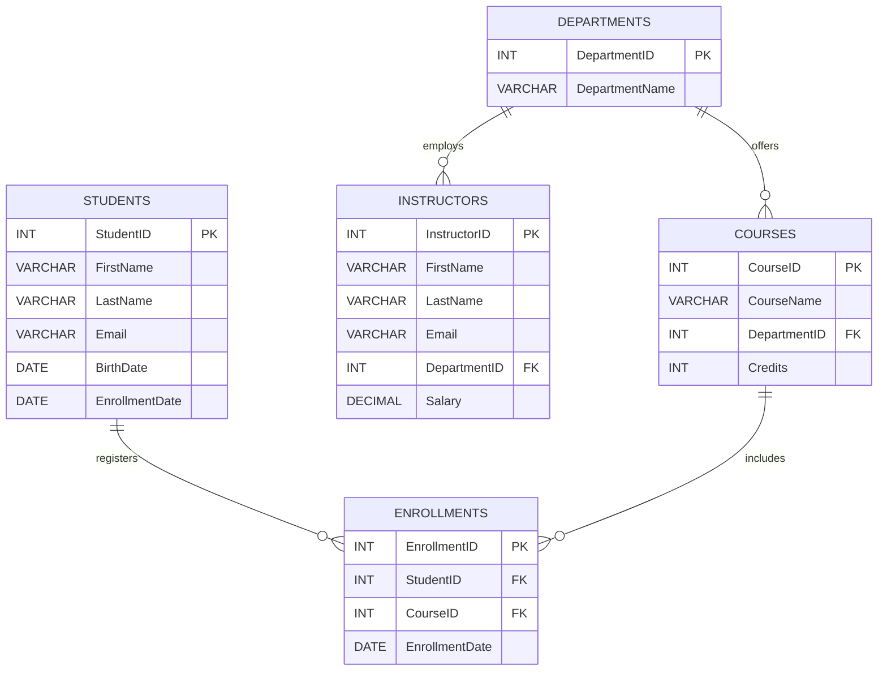
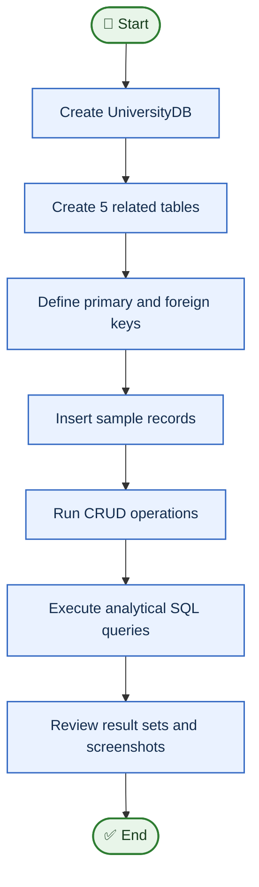

<div align="center">

# 🎓 University Database Management System

**A hands-on MySQL project in relational database design, data management, and analytical SQL.**


</div>

---

## 📌 Project Overview

The **University Database Management System** models core university information and demonstrates how SQL can be used to create related tables, manage records, and answer data questions. The database contains departments, students, courses, instructors, and course enrollments.

This project highlights practical SQL skills including **table design, primary and foreign keys, CRUD operations, joins, aggregate functions, subqueries, date functions, conditional logic, and window functions**. The screenshots in this README document the commands and their outputs from the supplied MySQL session.

## 🎯 Project Objectives

- Design a relational database for a university scenario.
- Connect related records using primary-key and foreign-key relationships.
- Practise inserting, reading, updating, and deleting records.
- Retrieve insights using filtering, joins, grouping, aggregate functions, and subqueries.
- Present query outputs as visual evidence of the work.

## 🧰 Tech Stack

- **Database:** MySQL
- **Query language:** SQL
- **Environment shown in screenshots:** MySQL command-line client
- **Version note:** MySQL 8.0+ is recommended for the window-function example.

## 🗂️ Database Tables

| Table | Purpose | Key relationships |
|---|---|---|
| `Departments` | Stores department IDs and names. | Referenced by `Courses` and `Instructors` |
| `Students` | Stores student names, email, birth date, and enrollment date. | Connected to courses through `Enrollments` |
| `Courses` | Stores course names, department IDs, and credits. | References `Departments`; referenced by `Enrollments` |
| `Instructors` | Stores instructor details and salary. | References `Departments` |
| `Enrollments` | Records which student enrolled in which course and on what date. | References `Students` and `Courses` |

## 🗺️ Entity Relationship Diagram



## 📊 Project Workflow



## 💡 SQL Concepts Demonstrated

| Concept | Examples from the project |
|---|---|
| Database and table design | `CREATE DATABASE`, `CREATE TABLE` |
| Referential integrity | `PRIMARY KEY`, `FOREIGN KEY` |
| CRUD operations | `INSERT`, `SELECT`, `UPDATE`, `DELETE` |
| Filtering and limiting | `WHERE`, `IN`, `YEAR()`, `LIMIT` |
| Joins | `INNER JOIN`, `LEFT JOIN` |
| Grouping and group filters | `GROUP BY`, `HAVING`, `COUNT()`, `COUNT(DISTINCT ...)` |
| Aggregate functions | `AVG()`, `MAX()` |
| Subqueries | Nested `SELECT` with `IN` and `HAVING` |
| Text and date functions | `CONCAT()`, `YEAR()`, `TIMESTAMPDIFF()`, `CURDATE()` |
| Conditional logic | `CASE ... WHEN ... THEN ... ELSE ... END` |
| Window functions | Running totals with `SUM(...) OVER (ORDER BY ...)` |

## 🖼️ Screenshots & Query Evidence

The screenshots below use **relative paths** inside the repository, so GitHub can display them when the `ss` folder is uploaded alongside this README.

### 1. 🏗️ Database Setup and CRUD

<table>
  <tr>
    <td width="50%"><strong>1. Create database and tables</strong><br></td>
    <td width="50%"><strong>2. Read table data</strong><br></td>
  </tr>
  <tr>
    <td colspan="2"><strong>3. Update and delete records</strong><br></td>
  </tr>
</table>

### 2. 🔎 Filtering and Course Queries

<table>
  <tr>
    <td width="50%"><strong>4. Students enrolled after 2022</strong><br></td>
    <td width="50%"><strong>5. Mathematics department courses (limit 5)</strong><br></td>
  </tr>
  <tr>
    <td><strong>6. Courses with more than five students</strong><br></td>
    <td><strong>7. Students enrolled in both courses</strong><br></td>
  </tr>
  <tr>
    <td><strong>8. Students enrolled in either course</strong><br></td>
    <td><strong>9. Average course credits</strong><br></td>
  </tr>
</table>

### 3. 📈 Aggregations, Joins, and Subqueries

<table>
  <tr>
    <td width="50%"><strong>10. Maximum Computer Science instructor salary</strong><br></td>
    <td width="50%"><strong>11. Students enrolled in each department</strong><br></td>
  </tr>
  <tr>
    <td><strong>12. INNER JOIN</strong><br></td>
    <td><strong>13. LEFT JOIN</strong><br></td>
  </tr>
  <tr>
    <td colspan="2"><strong>14. Subquery</strong><br></td>
  </tr>
</table>

### 4. 🧠 Date Functions, Text, and Window Logic

<table>
  <tr>
    <td width="50%"><strong>15. Extract enrollment year</strong><br></td>
    <td width="50%"><strong>16. Concatenate instructor names</strong><br></td>
  </tr>
  <tr>
    <td><strong>17. Running total of enrollments</strong><br></td>
    <td><strong>18. Senior / Junior labels</strong><br></td>
  </tr>
</table>

## ▶️ How to Run

1. Install **MySQL 8.0 or later** and start the MySQL server.
2. Open MySQL Workbench or the MySQL command-line client.
3. Review `UniversityDB.sql` and execute the SQL statements in your database session.
4. Run the queries individually to inspect their results.

> **Important:** The supplied `UniversityDB.sql` is a terminal transcript: it contains MySQL prompts such as `mysql>` / `->` and displayed output rows in addition to SQL statements. It is **not a clean, directly executable SQL script as-is**. Remove those prompts and output blocks before running the file as a script, or copy only the SQL statements into your SQL editor. The examples also insert and later delete the sample record with ID `3`, so later queries reflect the remaining records. Queries that return an empty set do so for the sample data and filters used in this exercise.

## 📁 Repository Structure

```text
UniversityDB_Project/
├── README.md
├── UniversityDB.sql
└── ss/
    ├── 01-create-database-tables.png
    ├── 02-read-table-data.png
    ├── 03-update-delete-records.png
    ├── 04-students-enrolled-after-2022.png
    ├── 05-mathematics-department-courses.png
    ├── 06-courses-with-more-than-five-students.png
    ├── 07-students-in-both-courses.png
    ├── 08-students-in-either-course.png
    ├── 09-average-course-credits.png
    ├── 10-max-cs-instructor-salary.png
    ├── 11-students-per-department.png
    ├── 12-inner-join.png
    ├── 13-left-join.png
    ├── 14-subquery.png
    ├── 15-extract-enrollment-year.png
    ├── 16-concatenate-instructor-name.png
    ├── 17-running-total-enrollments.png
    └── 18-senior-junior-labels.png
```

## 🌱 What This Project Demonstrates

This project provides practical evidence of relational data modelling and SQL query writing—from defining foreign-key relationships to using joins and analytical functions to answer questions about student enrollment, courses, departments, and instructors.

---

<div align="center">

**Thanks for checking out this project! 😊**

</div>
